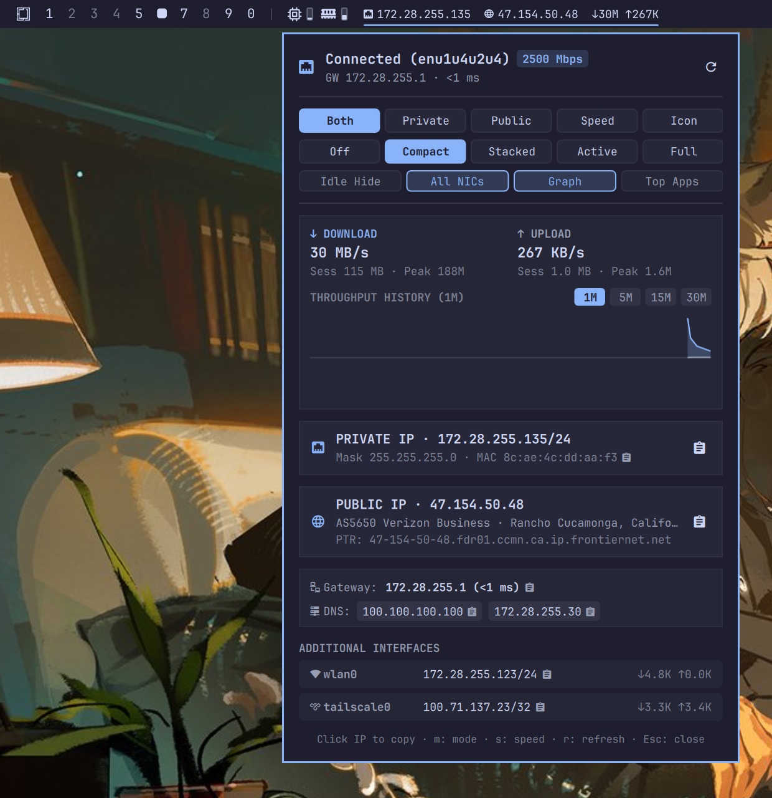

# Omarchy Network & IP Info (`nertwork.network-info`)

Unified network intelligence, IP telemetry, and live bandwidth monitor for the Omarchy status bar (`omarchy-shell`).



## Highlights

- **Unified Bar Telemetry** — Combine primary private IPv4, public/egress IPv4, and real-time download/upload throughput in a single status bar widget.
- **5 Bar Display Modes** — Switch between `both` (Private + Public IP), `private`, `public`, `speed` (dedicated compact speed mode), or `icon`.
- **5 Bar Speed Modes** — Choose `stacked` (ultra-compact two-line `↓ / ↑` stack), `compact` (`↓1.2M ↑84K`), `active` (dominant direction), `full` (`↓ 1.2 MB/s ↑ 84.0 KB/s`), or `off`.
- **Event-Driven Instant IP Updates** — Watches Linux kernel netlink events (`ip monitor address route`) to detect interface, VPN, DHCP, or route transitions in real time.
- **Mirrored Dual-Series Throughput Graph** — Interactive HTML5 Canvas area chart inside the popover with selectable `1M`, `5M`, `15M`, and `30M` windows plus hover crosshair inspection.
- **Rich Network Diagnostics & One-Click Copy** — Primary IPv4/CIDR, netmask, MAC, IPv6, link speed (`2500 Mbps` / Wi-Fi SSID & signal), default gateway with live ICMP latency, DNS resolvers, additional interfaces (`wlan0`, `tailscale0`, `tun*`, `docker0`) with per-NIC live rates, and top active TCP applications (`ss -tinp`).

## Installation and Removal

### Using Omarchy Plugin Manager

Install directly via the Omarchy plugin CLI:

```bash
omarchy plugin add https://github.com/nertwork/omarchy-network-info.git --enable
```

### Updating

```bash
omarchy plugin update nertwork.network-info
```

### Removal

```bash
omarchy plugin remove nertwork.network-info
```

### Declarative Configuration (`plugins.txt` & `shell.json`)

You can also add the plugin repository to `~/.config/omarchy/plugins.txt`:

```text
https://github.com/nertwork/omarchy-network-info
```

And configure `nertwork.network-info` in `~/.config/omarchy/shell.json` under `bar.layout.left`, `bar.layout.center`, or `bar.layout.right`:

```json
{
  "id": "nertwork.network-info",
  "displayMode": "both",
  "barSpeedMode": "stacked",
  "hideSpeedWhenIdle": false,
  "interfaceScope": "primary",
  "showGraph": true,
  "showPerApp": true,
  "chartWindow": 300,
  "speedInterval": 2000
}
```

## Dependencies

- **Omarchy Desktop / Omarchy Shell (`>=4.0.0`)** — Required Quickshell plugin host runtime.
- **Python 3** — Uses only the Python 3 standard library (`json`, `subprocess`, `urllib.request`, `ipaddress`) for `bin/network-info.py`.
- **`iproute2` (`ip`, `ss`)** — Used for interface address/route inspection, real-time netlink event monitoring (`ip monitor address route`), and per-application TCP socket telemetry (`ss -tinp`).
- **`iputils` (`ping`)** — Used for non-blocking default gateway ICMP latency probes.
- **`iw` (optional)** — Used to display Wi-Fi SSID, frequency, and signal strength (`dBm`) on wireless interfaces.
- **`wl-clipboard` (`wl-copy`)** — Used for one-click Wayland clipboard copying of IPs, subnets, gateways, DNS resolvers, and interface addresses.

## Bar & Popover Controls

| Action | Control |
|---|---|
| Toggle popover panel | Left-click bar widget |
| Force refresh local + public IP | Middle-click bar widget or press `r` in panel |
| Cycle bar IP display mode | Right-click bar widget or press `m` in panel |
| Cycle bar speed mode | Scroll wheel on bar widget or press `s` in panel |
| Copy Private / Public IP | Click IP card or press `1` / `2` in panel |

## IPC Commands

Control the widget from scripts or Hyprland keybindings via `omarchy-shell ipc call nertwork.network-info <command>`:

- `toggle`, `open`, `close`
- `refresh`
- `cycle`, `setMode <both|private|public|speed|icon>`, `getMode`
- `cycleSpeed`, `setSpeedMode <off|compact|stacked|active|full>`, `getSpeedMode`

## License

MIT License. See [LICENSE](LICENSE) for details.
